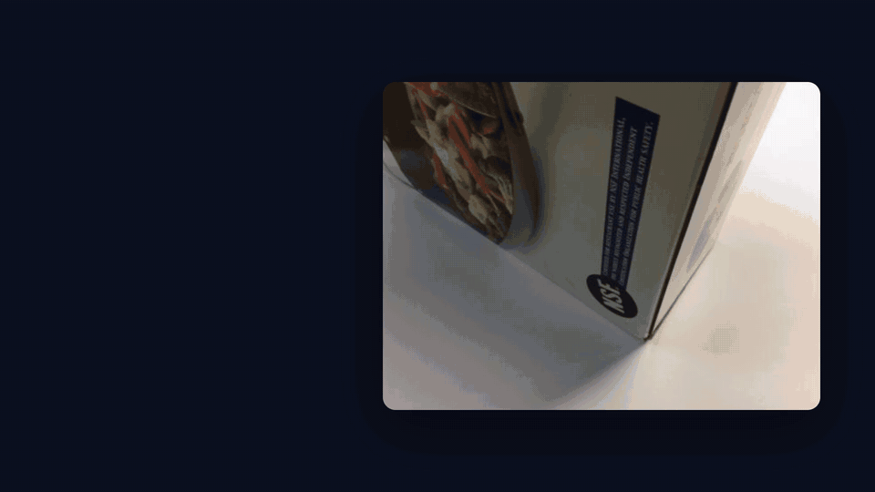
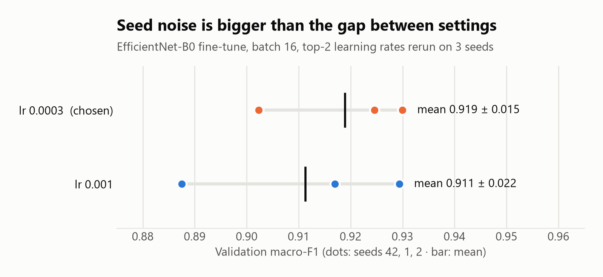
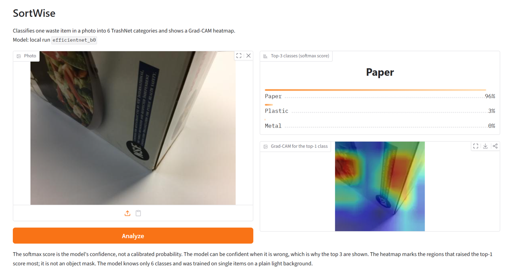

# SortWise — explainable waste classifier

Upload a photo of a single waste item and get the three most likely categories (cardboard, glass, metal, paper, plastic, other) together with a **Grad-CAM heatmap** of the parts of the image the model looked at.



22-second video with sound: [docs/demo.mp4](docs/demo.mp4)

**Test set (TrashNet, 379 images, used once): macro-F1 0.893 · accuracy 0.910** · EfficientNet-B0 · ~44 ms per image incl. heatmap on CPU

## More than "trained a CNN on a ready-made dataset"

Training was the smallest part. Most of the work went into checking that the result is real, reproducible and understandable.

1. **Data audit instead of trusting the dataset.** SHA-256 checksums revealed 3 pairs of identical images with **different labels** (e.g. the same file as both `glass` and `plastic`). The copies landed in both train and validation, inflating the score. All 6 files were removed, and the list is saved with the split.
2. **Reproducibility.** The same config gave 0.896 one time and 0.928 the next. Cause: the seed was set after the model was built and cuDNN picked algorithms non-deterministically. After the fix a rerun gives an identical result. Without this, comparing models would have meant comparing noise.
3. **Model choice backed by measurements.** 3 architectures × 2 variants (head only vs fine-tuning the last stage) compared on quality, weight size and CPU/GPU latency. Then a 12-run hyperparameter grid and the top 2 rerun on 3 seeds. I picked the **more stable** setting over the best single run, and documented that the gap is within seed-to-seed spread.
4. **Honest evaluation.** Macro-F1 is the main metric because the `trash` class is 3–4× smaller and accuracy would hide it. Hyperparameters were tuned on validation only. The test set was used **once**, at the end. The drop from 0.925 (val) to 0.893 (test) is reported, not hidden.
5. **Grad-CAM as an error-analysis tool.** Heatmaps confirmed the model looks at the item rather than the background, and explained the typical mistakes: flat cardboard without corrugation looks like a sheet of paper, the neck of a plastic bottle looks like glass. The model is wrong with 84–100% confidence, so the app shows the **top 3 classes** rather than a single answer.
6. **The model as a versioned artifact.** Weights, label map, config and metrics are published together to the Hugging Face Hub under an immutable tag (`v1`). The app loads a pinned version, so a rollback is one environment variable. I checked that the app reproduces the evaluation script's predictions (60/60 test images).
7. **Tests in CI.** GitHub Actions runs on every push and guards the failures that silently break experiments: leakage and duplicates across splits, seed reproducibility, Grad-CAM for every model and training mode, and the predictor contract (6 classes, scores sum to 1, correct heatmap shape).



Full tables, charts, confusion matrix and heatmap galleries: **[docs/results.md](docs/results.md)**.

## Where the model fails



A flat piece of cardboard with white print is classified as paper at 96%, and the true class is not even in the top 3. The heatmap focuses on the edge and fold, which look like a sheet of paper. It is the most common test error (5×), alongside plastic mistaken for glass.

| Class | F1 (test) | Most common error |
| --- | ---: | --- |
| Cardboard | 0.93 | 5× as paper |
| Paper | 0.92 | 3× as other |
| Plastic | 0.92 | 5× as glass |
| Glass | 0.91 | rare |
| Metal | 0.91 | 3× as glass |
| Other (`trash`) | 0.76 | 3× as paper |

## Limitations

- TrashNet shows single items on a plain light background. Performance on other backgrounds, lighting or several items at once is **not measured**.
- The model knows only 6 classes. A photo of anything else (e.g. a cat) still gets one of them.
- The softmax score is the model's confidence, not a calibrated probability.
- Grad-CAM shows what raised the class score. It is not an object mask or proof that the model "reasons correctly".
- The heatmap covers the 224×224 centre crop the model sees, not the whole uploaded photo.

## Run it

```bash
# PyTorch with CUDA (tested on an RTX 3070); without a GPU a plain `pip install torch torchvision` works
pip install torch torchvision --index-url https://download.pytorch.org/whl/cu128
pip install -r requirements.txt && pip install -e .
python scripts/check_cuda.py   # optional: confirms the GPU is visible

python app.py   # http://127.0.0.1:7860
```

Exact versions behind the reported results are pinned in [requirements-lock.txt](requirements-lock.txt).

The app loads the model from `artifacts/runs/final/efficientnet_b0`; `SORTWISE_RUN_DIR` points to another run. Without local weights it downloads the package from the Hugging Face Hub (`SORTWISE_MODEL_REPO`, default `gmorlo/sortwise-efficientnet-b0`) at version `SORTWISE_MODEL_VERSION` (default `v1`). A new version is published with `python scripts/publish_model.py --tag v2`; tags are immutable.

Full reproduction (data → split → training → evaluation → Grad-CAM galleries): the "Reproduce" section in [docs/results.md](docs/results.md). Tests: `pytest tests`.

Latency per image (prediction + Grad-CAM, median): ~44 ms on a desktop CPU, ~35 ms on an RTX 3070.

## Stack

PyTorch + torchvision (CUDA for training, CPU for inference) · EfficientNet-B0 · Grad-CAM (own hook-based implementation) · scikit-learn (metrics, split) · Gradio · Hugging Face Hub (model versioning) · GitHub Actions · pytest

## Layout

```
src/sortwise/
  data/        TrashNet download, SHA-256 manifest, dedup, stratified split, transforms
  models/      backbones (ResNet18, EfficientNet-B0, MobileNetV3) with head/finetune modes
  training/    training loop, early stopping on macro-F1, seeding, metrics
  explain/     Grad-CAM and heatmap overlay
  inference.py loads a versioned model + prediction with heatmap
scripts/       training, model comparison, grid search, evaluation, galleries, model publishing
app.py         Gradio demo
docs/          results, findings, figures
```

## Next

Analysis history and user corrections, evaluation on own photos with other backgrounds, an in-browser demo without a server (ONNX).

## License

Code: [MIT](LICENSE). Data: [TrashNet](https://github.com/garythung/trashnet) by Gary Thung and Mindy Yang, under its own license; the dataset is not included in this repository. The trained weights are derived from TrashNet and ImageNet-pretrained torchvision models.
