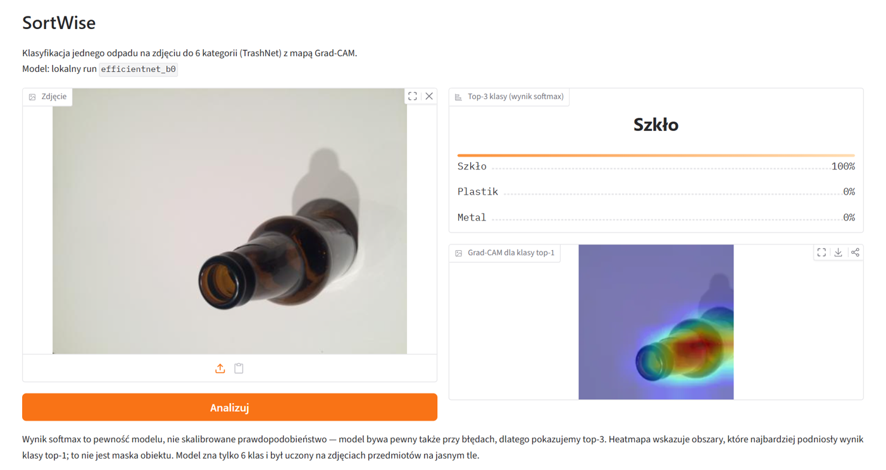

# SortWise — wyjaśnialny klasyfikator odpadów

Wgrywasz zdjęcie jednego odpadu, a aplikacja pokazuje trzy najbardziej prawdopodobne kategorie (karton, szkło, metal, papier, plastik, pozostałe) i **heatmapę Grad-CAM**, czyli fragmenty zdjęcia, na które model patrzył przy decyzji.



**Test (TrashNet, 379 zdjęć, użyty raz): macro-F1 0.893 · accuracy 0.910** · EfficientNet-B0 · ~44 ms na zdjęcie z heatmapą na CPU

## Co tu jest poza „wytrenowałem CNN na gotowym zbiorze”

Sam trening to najmniejsza część projektu. Większość pracy to sprawdzanie, czy wynik jest prawdziwy, powtarzalny i zrozumiały.

1. **Audyt danych zamiast zaufania do gotowego zbioru.** Sumy kontrolne SHA-256 wykazały 3 pary identycznych zdjęć z **różnymi etykietami**, np. ten sam plik jako `glass` i `plastic`. Kopie trafiały jednocześnie do zbioru treningowego i walidacyjnego, więc wynik walidacji był zawyżony. Wszystkie 6 plików zostało usuniętych, a ich lista jest zapisana w splicie.
2. **Powtarzalność wyników.** Ta sama konfiguracja raz dawała 0.896, a raz 0.928 macro-F1. Przyczyna: seed był ustawiany po zbudowaniu modelu, a cuDNN sam dobierał algorytmy. Po poprawce powtórka daje identyczny wynik. Bez tego porównywanie modeli byłoby porównywaniem szumu.
3. **Wybór modelu na podstawie pomiarów.** 3 architektury × 2 warianty (sama głowa lub fine-tuning ostatniego bloku) porównane pod kątem jakości, rozmiaru wag i czasu na CPU i GPU. Potem siatka 12 kombinacji hiperparametrów i powtórki dwóch najlepszych na 3 seedach. Wybrałem ustawienie **stabilniejsze**, a nie to z najlepszym pojedynczym runem, i opisałem, że różnica mieści się w rozrzucie między seedami.
4. **Uczciwa ocena.** Główną miarą jest macro-F1, bo klasa `trash` jest 3–4× mniejsza i accuracy by to ukryło. Hiperparametry dobierane były wyłącznie na walidacji. Zbiór testowy został użyty **jeden raz**, na końcu. Spadek z 0.925 (walidacja) do 0.893 (test) jest pokazany, a nie ukryty.
5. **Grad-CAM jako narzędzie do analizy błędów.** Heatmapy pokazały, że model patrzy na przedmiot, a nie na tło, i wyjaśniły typowe pomyłki. Płaski karton bez falistej struktury wygląda dla modelu jak kartka. Szyjka plastikowej butelki wygląda jak szklana. Model myli się z pewnością 84–100%, dlatego aplikacja pokazuje **top‑3 klasy**, a nie jedną odpowiedź.
6. **Model jako wersjonowany artefakt.** Wagi, mapowanie klas, konfiguracja i metryki są publikowane razem na HF Hub pod niezmiennym tagiem (`v1`). Aplikacja ładuje wskazaną wersję, więc cofnięcie modelu to zmiana jednej zmiennej. Sprawdziłem, że aplikacja daje te same predykcje co skrypt ewaluacji (60/60 zdjęć testowych).
7. **Testy w CI.** GitHub Actions przy każdym pushu pilnuje błędów, które psują eksperymenty po cichu: przecieku i duplikatów między splitami, powtarzalności seeda, działania Grad-CAM dla wszystkich modeli i trybów oraz kontraktu predyktora (6 klas, suma wyników 1, poprawny rozmiar heatmapy).

Szczegóły z tabelami, macierzą pomyłek i galeriami heatmap: **[docs/results.md](docs/results.md)**.

## Gdzie model się myli


Płaski karton z białym nadrukiem model rozpoznał jako papier z wynikiem 96%, a prawdziwej klasy nie ma nawet w top‑3. Heatmapa skupia się na krawędzi i zagięciu, które wyglądają jak kartka. To najczęstsza pomyłka w teście (5×), obok plastiku branego za szkło.

| Klasa | F1 (test) | Najczęstszy błąd |
| --- | ---: | --- |
| Karton | 0.93 | 5× jako papier |
| Papier | 0.92 | 3× jako pozostałe |
| Plastik | 0.92 | 5× jako szkło |
| Szkło | 0.91 | rzadkie |
| Metal | 0.91 | 3× jako szkło |
| Pozostałe (`trash`) | 0.76 | 3× jako papier |

## Ograniczenia

- TrashNet to pojedyncze przedmioty na jasnym tle. Jak model radzi sobie z innym tłem, oświetleniem czy kilkoma przedmiotami naraz, **nie jest zmierzone**.
- Model zna tylko 6 klas. Zdjęcie czegoś spoza nich (np. kota) też dostanie jedną z tych kategorii.
- Wynik softmax to pewność modelu, a nie skalibrowane prawdopodobieństwo.
- Grad-CAM pokazuje, co podniosło wynik klasy. Nie jest maską obiektu ani dowodem, że model „rozumuje poprawnie”.
- Heatmapa dotyczy środkowego kadru 224×224, który widzi model, a nie całego wgranego zdjęcia.

## Uruchomienie

```bash
# PyTorch z CUDA (sprawdzone na RTX 3070); bez GPU działa zwykły pip install torch torchvision
pip install torch torchvision --index-url https://download.pytorch.org/whl/cu128
pip install -r requirements.txt && pip install -e .

python app.py   # http://127.0.0.1:7860
```

Aplikacja bierze model z `artifacts/runs/final/efficientnet_b0`, a inny katalog wskazuje zmienna `SORTWISE_RUN_DIR`. Jeśli lokalnych wag nie ma, pobiera pakiet z HF Hub (`SORTWISE_MODEL_REPO`, domyślnie `gmorlo/sortwise-efficientnet-b0`, na razie prywatne) w wersji `SORTWISE_MODEL_VERSION` (domyślnie `v1`). Nową wersję publikuje `python scripts/publish_model.py --tag v2`, a tagi są niezmienne.

Pełne odtworzenie (dane → split → trening → ewaluacja → galerie Grad-CAM): sekcja „Odtworzenie” w [docs/results.md](docs/results.md). Testy: `pytest tests`.

Czas analizy jednego zdjęcia (predykcja + Grad-CAM, mediana): ~44 ms na CPU desktopa, ~35 ms na RTX 3070.

## Stack

PyTorch + torchvision (CUDA do treningu, CPU do inferencji) · EfficientNet-B0 · Grad-CAM (własna implementacja na hookach) · scikit-learn (metryki, split) · Gradio · Hugging Face Hub (wersjonowanie modelu) · GitHub Actions · pytest

## Struktura

```
src/sortwise/
  data/        pobranie TrashNet, manifest z SHA-256, deduplikacja, stratyfikowany split, transformacje
  models/      backbony (ResNet18, EfficientNet-B0, MobileNetV3) z trybami head/finetune
  training/    pętla treningowa, early stopping na macro-F1, seed, metryki
  explain/     Grad-CAM i nakładanie heatmapy
  inference.py ładowanie wersjonowanego modelu + predykcja z heatmapą
scripts/       trening, porównanie modeli, grid search, ewaluacja, galerie, publikacja modelu
app.py         demo Gradio
docs/          wyniki, wnioski, wykresy
```

## Dalej

Historia analiz i poprawianie kategorii przez użytkownika, ocena na własnych zdjęciach z innym tłem, demo w przeglądarce bez serwera (ONNX).

Dane: [TrashNet](https://github.com/garythung/trashnet) (Gary Thung, Mindy Yang).
