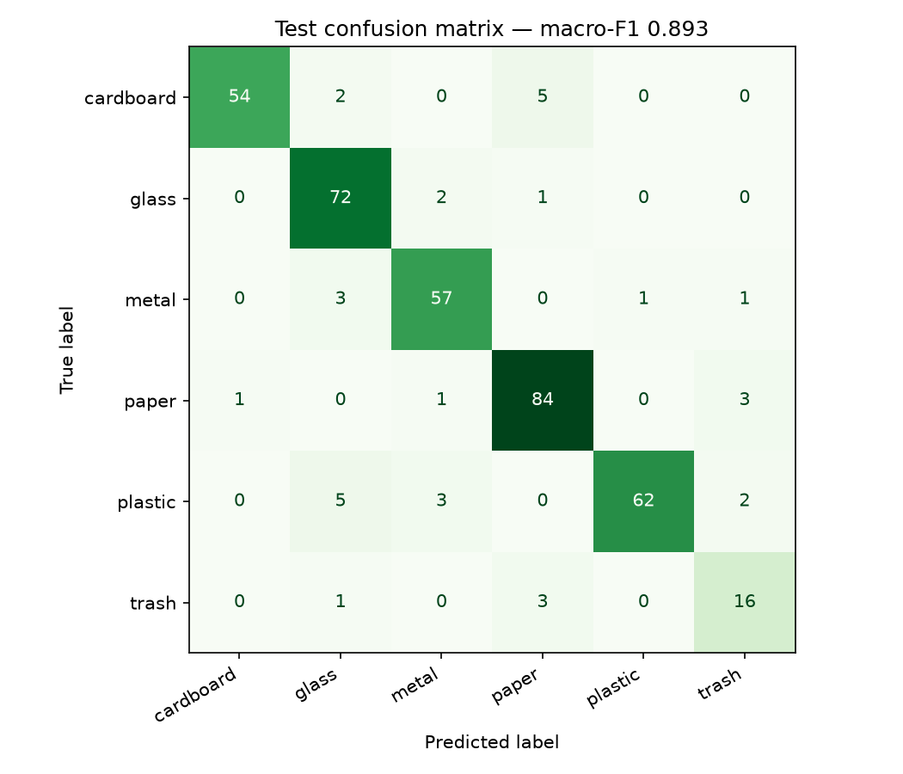
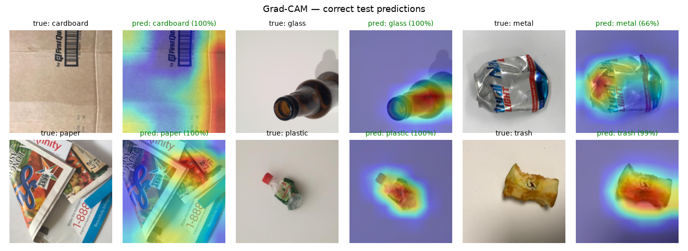
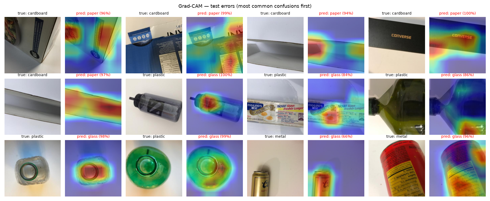

# Results and findings

As of 2026-10-28. All training on an NVIDIA RTX 3070 (CUDA), PyTorch 2.11.
Data: TrashNet `dataset-resized`, 2521 images after duplicate removal, 70/15/15 split (seed 42, stratified).
Main metric: **macro-F1** — the `trash` class (137 images) is 3–4× smaller than the others, and accuracy would hide that.

## 1. Problems found in the data and the code

| Problem | Effect | Fix |
| --- | --- | --- |
| 3 pairs of identical files (same SHA-256) with **different labels**: `glass115`=`metal91`, `glass176`=`plastic152`, `glass389`=`plastic332` | Wrong label + leakage: copies ended up in both train and val | `drop_duplicates` in `split.py` removes all 6 (the true label is unknown); listed in `splits.json → excluded` |
| Seed set only after the model was built, cuDNN autotuning on | The same config gave 0.896 or 0.928 | `set_seed` before `build_model` + `cudnn.deterministic`; a rerun now gives an identical result |

Both were found during a code audit. All results below are after the fix.

## 2. Architecture comparison (validation)

Finetune = last network stage + classifier trained; head = classifier only.

| Model | Variant | Val macro-F1 | Weights MB | CPU ms / image | GPU ms / image |
| --- | --- | ---: | ---: | ---: | ---: |
| **EfficientNet-B0** | finetune | **0.914** | 16.3 | 12.8 | 4.9 |
| ResNet18 | finetune | 0.910 | 44.8 | 8.3 | 2.9 |
| MobileNetV3-Small | finetune | 0.875 | 6.2 | 5.1 | 3.3 |
| EfficientNet-B0 | head | 0.834 | 16.3 | 14.8 | 5.0 |
| MobileNetV3-Small | head | 0.811 | 6.2 | 3.9 | 3.4 |
| ResNet18 | head | 0.780 | 44.8 | 8.3 | 2.9 |

Findings:
- Fine-tuning the last stage adds +0.06–0.13 macro-F1 over training the head alone.
- EfficientNet-B0 and ResNet18 are close; EfficientNet was chosen for the best score at ~3× smaller weights. 13 ms on a desktop CPU is fast enough for an interactive demo.

## 3. EfficientNet-B0 finetune hyperparameters

A 3 × 2 × 2 grid = 12 runs (lr × batch × weight decay), seed 42:
- **Batch 16 > 32** — all top-5 results used batch 16.
- **Weight decay barely matters** — at lr 1e-4 results with and without it were identical.
- Best: lr 1e-3 (0.929) and lr 3e-4 (0.925), batch 16, wd 0.

Top-2 rerun on three seeds (42, 1, 2):

| LR | Seed 42 | Seed 1 | Seed 2 | Mean ± std |
| ---: | ---: | ---: | ---: | ---: |
| **3e-4** | 0.925 | 0.930 | 0.902 | **0.919 ± 0.015** |
| 1e-3 | 0.929 | 0.917 | 0.888 | 0.911 ± 0.022 |

Choice: **lr 3e-4, batch 16, wd 0** (`configs/final_efficientnet_b0.yaml`) — higher mean and lower spread.
The gap between the settings (0.008) is smaller than the spread between seeds, so this picks the more stable option; it is not evidence of a clear advantage.

## 4. Final test-set result

The test set was used **once**, after all decisions were made.

| Metric | Validation | Test |
| --- | ---: | ---: |
| Macro-F1 | 0.925 | **0.893** |
| Accuracy | 0.929 | **0.910** |

The val → test drop is expected: settings were chosen on validation.



| Class | F1 | Most common error |
| --- | ---: | --- |
| Cardboard | 0.93 | 5× as paper |
| Paper | 0.92 | 3× as trash |
| Plastic | 0.92 | 5× as glass |
| Glass | 0.91 | rare |
| Metal | 0.91 | 3× as glass |
| Trash | 0.76 | 3× as paper |

Findings:
- Visually similar pairs get confused: **cardboard ↔ paper** (material, colour) and **plastic ↔ glass** (transparency, reflections).
- `trash` is the weakest: few examples (20 in test) and no single typical look.
- TrashNet is mostly single items on a light background — this result says nothing about photos with other backgrounds (a separate test on own photos: to do).

## 5. Explainability: Grad-CAM

The heatmap shows which image regions raised the predicted class score the most (last convolutional block, `features[-1]` in EfficientNet-B0). It hints at where the model "looks" — it is not an object mask or proof of correct reasoning.



For correct predictions the model looks at the item itself (bottle neck, can, apple core), not at the white background.



Findings from the errors:
- **Cardboard → paper:** the confused pieces are flat, thin or white cardboard; the model looks at edges and folds that resemble a sheet of paper. No corrugated structure in the photo = no "cardboard" cue.
- **Plastic → glass:** clear and green bottles seen from the neck; the heatmap focuses on the round opening — a shape typical of glass bottles.
- **Metal → glass:** shiny, reflective cans.
- Many errors have a **high softmax score (84–100%)**. The model is confident even when wrong, so a confidence threshold alone will catch few errors — which is why the app shows the top 3 classes, not just one.

## Reproduce

```bash
python scripts/prepare_split.py
python scripts/train.py --config configs/final_efficientnet_b0.yaml --variant finetune --run-name final/efficientnet_b0
python scripts/evaluate.py
python scripts/gradcam_gallery.py
```
